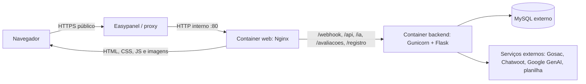

# Tutorial de Docker e Docker Compose do Monitor.IA

Este tutorial usa os arquivos deste projeto para explicar Docker desde os conceitos básicos até a implantação no Easypanel. Ele é voltado a quem está começando e quer entender o que cada arquivo faz, como os containers conversam e como investigar problemas.

## 1. O que Docker resolve

Uma aplicação depende de código, bibliotecas, configuração e um ambiente de execução. Sem Docker, cada servidor precisa receber e configurar essas partes manualmente. Uma **imagem Docker** empacota o ambiente e as instruções para iniciar um processo. Um **container** é uma execução dessa imagem, isolada dos outros processos do servidor.

Uma imagem é como um molde; o container é uma instância criada a partir desse molde. O container não é uma máquina virtual completa: ele usa o kernel Linux do host, mas tem seu próprio processo, rede e sistema de arquivos isolado.

Neste projeto, o backend Flask é construído a partir de um Dockerfile. O frontend usa uma imagem pronta do Nginx. O Docker Compose descreve como executar ambos juntos.

## 2. Mapa dos arquivos

```text
docker/
├── Dockerfile                # instruções para construir a imagem Flask
├── docker-compose.yml        # serviços e ligações entre os containers
├── nginx/
│   ├── site.conf             # configuração ativa do Nginx para arquivos e APIs
│   └── frontend.conf         # configuração alternativa/antiga, não usada pelo Compose
└── README.md                 # tutorial de implantação no Easypanel

backend/                      # aplicação Flask e requirements.txt
auth/                         # páginas HTML, incluindo login e painel
css/                          # estilos do frontend
script/                       # JavaScript do frontend
assets/                       # imagens e outros recursos estáticos
.env.docker.example           # nomes das variáveis necessárias, sem segredos
.gitignore                    # impede adicionar .env ao Git
.dockerignore                 # impede enviar arquivos desnecessários ao build
```

O Compose está em `docker/docker-compose.yml`, mas seu **build context** é a raiz do repositório. Por isso os caminhos `backend/`, `auth/`, `css/`, `script/` e `assets/` podem ser usados a partir dali.

## 3. A arquitetura deste projeto



O Easypanel publica o serviço `web`. O Nginx serve os arquivos estáticos e encaminha chamadas de API para o serviço `backend`. O backend acessa MySQL e integrações externas. O MySQL não está declarado no Compose deste projeto; ele precisa existir e aceitar conexões do servidor.

Há **um serviço Compose** no painel Easypanel e **dois serviços Compose** no YAML: `web` e `backend`. Na prática, o Compose cria um container para cada serviço definido. O nome do serviço é também um nome DNS dentro da rede privada do Compose.

## 4. Entendendo o Dockerfile do backend

O arquivo `docker/Dockerfile` transforma o código Python em uma imagem executável:

```dockerfile
FROM python:3.12-slim

ENV PYTHONDONTWRITEBYTECODE=1 \
    PYTHONUNBUFFERED=1

WORKDIR /app

RUN addgroup --system app && adduser --system --ingroup app app

COPY backend/requirements.txt ./requirements.txt
RUN pip install --no-cache-dir -r requirements.txt

COPY --chown=app:app backend/ .

USER app

EXPOSE 5001
CMD ["gunicorn", "--no-control-socket", "--bind", "0.0.0.0:5001", "--workers", "2", "--timeout", "180", "app:app"]
```

Linha por linha:

| Instrução | O que significa neste projeto |
| --- | --- |
| `FROM python:3.12-slim` | Usa uma imagem base Linux pequena que já contém Python 3.12. |
| `ENV ...` | Evita arquivos `.pyc` desnecessários e faz a saída Python aparecer imediatamente nos logs do container. |
| `WORKDIR /app` | Define `/app` como pasta corrente para as próximas instruções e para o processo. |
| `RUN addgroup ... adduser ...` | Cria um usuário de sistema sem privilégios administrativos. |
| `COPY backend/requirements.txt ...` | Copia primeiro a lista de dependências. |
| `RUN pip install ...` | Instala Flask, Gunicorn, conectores e bibliotecas declaradas em `requirements.txt`. |
| `COPY --chown=app:app backend/ .` | Copia o backend para a imagem e atribui a propriedade ao usuário da aplicação. |
| `USER app` | Executa a aplicação como usuário sem privilégios, em vez de `root`. |
| `EXPOSE 5001` | Documenta que a aplicação escuta na porta 5001 dentro do container. **Não** publica a porta no servidor. |
| `CMD [...]` | Define o processo iniciado quando o container sobe: Gunicorn carrega `app:app` e escuta em todas as interfaces na porta 5001. |

### Por que copiar o arquivo de dependências antes do código?

O Docker constrói a imagem em camadas e reutiliza camadas que não mudaram. Como `requirements.txt` muda menos do que o código, essa ordem permite reaproveitar a instalação de dependências em muitos builds. Se copiar o projeto inteiro antes, qualquer alteração no código poderia invalidar a camada de instalação e fazer o build reinstalar tudo.

### O que é Gunicorn e por que usar `0.0.0.0`?

Flask é o framework da aplicação. Gunicorn é o servidor WSGI que mantém processos de trabalho para atender requisições em produção. `0.0.0.0:5001` significa escutar em todas as interfaces de rede do container. Se escutasse somente em `127.0.0.1`, outros containers não conseguiriam alcançar o backend.

`--workers 2` inicia dois processos trabalhadores. `--timeout 180` permite até 180 segundos para uma requisição antes de o Gunicorn considerá-la travada, útil para algumas rotas demoradas deste projeto. `--no-control-socket` desativa um socket opcional de administração do Gunicorn que não é usado pela aplicação.

## 5. Entendendo o Docker Compose

Docker Compose lê um arquivo YAML e controla vários containers como uma aplicação. A parte principal do `docker/docker-compose.yml` é:

```yaml
services:
  backend:
    build:
      context: ..
      dockerfile: docker/Dockerfile
    restart: unless-stopped
    env_file:
      - ../.env

  web:
    image: nginx:1.27-alpine
    restart: unless-stopped
    depends_on:
      - backend
    volumes:
      - ./nginx/site.conf:/etc/nginx/conf.d/default.conf:ro
      - ../auth:/usr/share/nginx/html/auth:ro
      - ../css:/usr/share/nginx/html/css:ro
      - ../script:/usr/share/nginx/html/script:ro
      - ../assets:/usr/share/nginx/html/assets:ro
```

| Campo | Explicação |
| --- | --- |
| `services` | Inicia a definição dos serviços que compõem a aplicação. |
| `backend` | Nome do serviço e DNS interno usado pelos outros containers. |
| `build.context: ..` | Raiz do contexto de build é a pasta acima de `docker/`, ou seja, a raiz do repositório. O Docker só pode copiar arquivos que estejam dentro desse contexto. |
| `dockerfile: docker/Dockerfile` | Dockerfile a ser executado, relativo à raiz do contexto. |
| `image: nginx:1.27-alpine` | Para `web`, baixa a imagem pronta do Nginx baseada em Alpine Linux. Não há Dockerfile próprio para esse container. |
| `restart: unless-stopped` | Reinicia o container após falha ou reinício do Docker, exceto se alguém o tiver parado explicitamente. |
| `env_file` | Lê variáveis do arquivo `.env` e as entrega ao container `backend`. |
| `depends_on` | Pede que o Compose inicie `backend` antes de `web`. Isso ordena o início, mas não garante que o MySQL ou a aplicação já estejam prontos para responder. |
| `volumes` | Monta arquivos/pastas do repositório dentro do container Nginx. |
| `:ro` | Monta como somente leitura: o container consegue ler os arquivos, mas não alterá-los. |

### Rede interna do Compose

Por padrão, o Compose cria uma rede privada para os serviços do projeto. Nessa rede, `web` encontra o backend pelo nome DNS `backend`. Por isso a configuração do Nginx usa `http://backend:5001`, e não `localhost`.

Dentro de `web`, `localhost` significa o próprio container Nginx. Dentro de `backend`, significa o próprio container Flask. O nome `backend` aponta de `web` para o outro container.

Não há `ports:` no Compose usado pelo Easypanel. A porta 5001 não deve ficar exposta publicamente, e a porta 80 do Nginx é acessada pelo proxy do Easypanel na rede de serviços. `EXPOSE` no Dockerfile também não abre a porta para a internet.

### Bind mounts e volumes

Os `volumes` deste Compose são **bind mounts**: eles conectam pastas do código baixado no servidor a caminhos dentro do container Nginx. Assim, `auth/` do repositório fica disponível como `/usr/share/nginx/html/auth`.

Um **volume nomeado** é diferente: o Docker administra um espaço de dados persistente, geralmente usado para bancos de dados. Este projeto não declara volume nomeado porque o MySQL é externo. Os diretórios estáticos são código e não precisam ser volumes de dados graváveis.

Arquivos temporários enviados ao backend devem ser considerados efêmeros: o container pode ser substituído em um deploy. Dados importantes e permanentes devem ficar no banco ou em armazenamento persistente apropriado, não apenas no sistema de arquivos do container.

## 6. Como o Nginx liga o site à API

O arquivo `docker/nginx/site.conf` configura o Nginx. É ele que o Compose monta em `/etc/nginx/conf.d/default.conf`. O arquivo `docker/nginx/frontend.conf` também existe no repositório, mas não é referenciado pelo Compose atual; alterá-lo sozinho não muda o container implantado.

```nginx
server {
    listen 80;
    server_name _;
    root /usr/share/nginx/html;
    index auth/login.html;
    client_max_body_size 50m;

    location = / {
        return 302 /auth/login.html;
    }

    location ~ ^/(webhook|api|ia|avaliacoes|registro)/ {
        proxy_pass http://backend:5001;
        proxy_read_timeout 180s;
        proxy_set_header Host $host;
        proxy_set_header X-Real-IP $remote_addr;
        proxy_set_header X-Forwarded-For $proxy_add_x_forwarded_for;
        proxy_set_header X-Forwarded-Proto $scheme;
    }

    location / {
        try_files $uri $uri/ =404;
    }
}
```

- `listen 80` é a porta HTTP **interna** do container `web`.
- `root` aponta para o lugar em que os arquivos estáticos foram montados.
- `location = /` redireciona a raiz para `/auth/login.html`. Isso mantém a URL na pasta `auth`, necessária porque os links e redirecionamentos do frontend são relativos a essa pasta.
- O bloco `location ~` seleciona as rotas de API listadas e as encaminha ao backend pelo DNS interno `backend`, porta `5001`.
- `proxy_read_timeout 180s` combina com rotas que podem levar mais tempo para responder.
- `proxy_set_header` encaminha ao backend o host e informações da requisição original.
- `try_files` procura o arquivo/pasta solicitado e retorna 404 se não existir. Assim o Nginx entrega HTML, CSS, JavaScript e imagens sem envolver Flask.
- `client_max_body_size 50m` permite uploads de até 50 MB para o Nginx encaminhar às rotas do backend.

HTTPS termina no proxy do Easypanel. O proxy se comunica com o Nginx por HTTP interno na porta 80; o certificado não precisa ser instalado neste Nginx.

## 7. Variáveis e segredos

`.env.docker.example` lista os nomes das variáveis. O arquivo `.env` contém os valores reais. **O `.env` real não deve ser enviado ao Git nem incluído em imagem Docker.**

O `.gitignore` evita que `.env` seja incluído em commits locais. O `.dockerignore` evita que esse e outros arquivos desnecessários entrem no contexto do Docker. São proteções diferentes: Git e Docker recebem arquivos por processos distintos.

No Easypanel, cadastre as variáveis na seção **Environment** e habilite **Create a .env file**. O Compose espera o `.env` na raiz do Build Path, e o serviço `backend` lê as variáveis por `env_file: ../.env`.

Grupos importantes de variáveis deste projeto:

- `DB_*`: banco de login.
- `DB_*2` e `DB_USER22`: banco usado por avaliações, IA e registros. `DB_USER2` e `DB_USER22` são nomes distintos porque rotas diferentes os leem.
- `JWT_SECRET_KEY`: segredo de assinatura dos tokens de login. Mantenha-o privado. Se um token ou esse segredo for exposto, troque esse valor e redeploy para invalidar tokens existentes.
- `GOSAC_*`, `CHATWOOT_*`, `GOOGLE_GENAI_API_KEY` e `EXCEL_URL`: configurações de integrações externas.

Se uma variável obrigatória estiver ausente, o backend pode iniciar e só falhar quando a rota que usa aquela variável for chamada. Portanto, “container running” não prova que banco e serviços externos estejam acessíveis.

## 8. Subir localmente para aprender

Instale Docker Desktop no Windows e confirme que ele está em execução. Na raiz deste repositório, no PowerShell:

```powershell
docker version
docker compose version
```

Crie o arquivo local de variáveis a partir do modelo e preencha os dados de teste:

```powershell
Copy-Item .env.docker.example .env
```

Não coloque credenciais de produção em um ambiente de estudo. O MySQL configurado precisa estar acessível pelo Docker Desktop; `localhost` dentro do container significa o próprio container e não o computador host.

O Compose atual não publica uma porta no host, porque foi preparado para o proxy do Easypanel. Para testar localmente, acrescente temporariamente esta configuração ao serviço `web`:

```yaml
    ports:
      - "8080:80"
```

Essa linha mapeia a porta `8080` do seu computador para a `80` do container Nginx. Depois, na raiz do repositório:

```powershell
docker compose -f docker/docker-compose.yml up -d --build
```

Abra `http://localhost:8080/`. Para interromper e remover os containers e a rede criada pelo Compose:

```powershell
docker compose -f docker/docker-compose.yml down
```

`down` não apaga o código nem um banco MySQL externo. Não use a porta `80` do host se ela já estiver ocupada por outro servidor web. Antes de enviar mudanças ao GitHub/Easypanel, remova a publicação local `ports:` se a adicionou ao Compose.

## 9. Comandos essenciais para investigar

Execute-os na raiz do repositório:

```powershell
# Ver containers e estado
docker compose -f docker/docker-compose.yml ps

# Seguir logs do backend
docker compose -f docker/docker-compose.yml logs -f backend

# Seguir logs do Nginx
docker compose -f docker/docker-compose.yml logs -f web

# Ver os últimos registros sem acompanhar continuamente
docker compose -f docker/docker-compose.yml logs --tail 100 backend web

# Abrir um shell dentro do container do backend
docker compose -f docker/docker-compose.yml exec backend sh

# Verificar a sintaxe da configuração Nginx dentro do container
docker compose -f docker/docker-compose.yml exec web nginx -t
```

`docker compose ps` informa se os containers estão executando. Logs do Gunicorn mostrando `Listening at: http://0.0.0.0:5001` indicam que o servidor iniciou; logs do Nginx mostrando `start worker processes` indicam que o servidor web iniciou. Isso não testa automaticamente o banco, o login ou o domínio.

Ao fazer deploy, o Easypanel pode parar o container antigo com `SIGTERM` e iniciar outro. Linhas `Handling signal: term` seguidas de `Starting gunicorn` podem ser parte normal dessa substituição. Se o ciclo continuar se repetindo sem um deploy, investigue o estado do serviço e as linhas de erro antes do reinício.

## 10. O ciclo de build e deploy

1. O Easypanel baixa a branch Git configurada.
2. O Compose lê o YAML e o `.env` gerado pelo painel.
3. O Docker constrói `backend` usando a raiz como contexto e o `docker/Dockerfile`.
4. O Docker baixa `nginx:1.27-alpine` para `web` se ainda não estiver no servidor.
5. O Compose cria/usa uma rede privada e inicia `backend` e `web`.
6. O proxy do Easypanel direciona o domínio para `web`, porta `80`.
7. O Nginx serve o frontend e encaminha APIs ao backend.

Este fluxo não exige criar uma imagem manualmente nem enviá-la ao Docker Hub. O Easypanel constrói a imagem do backend a partir do Dockerfile. Docker Hub (ou outro registry) é necessário se você optar por construir a imagem em outro lugar e pedir ao servidor que a baixe pronta.

Para aplicar uma alteração: faça commit e push para a branch configurada, depois execute **Deploy** no Easypanel. Alterar arquivos no computador não muda o container remoto até esses passos serem feitos. Não inclua `.env` no commit.

No painel, configure o domínio para o serviço Compose `web`, protocolo HTTP, porta `80` e caminho `/`. O SSL público é administrado pelo Easypanel. Não exponha `backend:5001` diretamente ao público.

## 11. O que aprender em seguida

### Healthchecks e prontidão

`depends_on` controla a ordem inicial, mas não espera que uma aplicação esteja pronta. Em projetos maiores, configure um healthcheck que verifique um endpoint de saúde real e use dependência condicionada a `service_healthy`. Isso requer criar uma rota de saúde no backend e uma ferramenta/comando de verificação disponível na imagem. Sem isso, um container pode estar “running” mas ainda não conseguir atender requisições.

### Persistência

Container pode ser removido e recriado. Para banco dentro do Compose, dados devem ficar em um volume nomeado, e não somente dentro da camada gravável do container. Neste projeto o banco está fora do Compose, então planeje backups e segurança no provedor MySQL.

### Escala e proxy

Quando o tráfego crescer, estude múltiplos workers Gunicorn, limites de CPU/memória, logs estruturados e balanceamento de carga. Se executar mais de uma réplica do backend, o Nginx/Compose precisa saber encaminhar para todas e qualquer estado de sessão ou arquivo deve estar em armazenamento compartilhado/apropriado.

### Imagens reprodutíveis

Versões fixas de imagem e dependências tornam os builds mais previsíveis. `nginx:1.27-alpine` fixa a série da imagem, enquanto dependências Python sem versões fixas podem mudar entre builds. Em ambientes mais críticos, defina versões testadas, atualize-as de propósito e use um registry privado ou público com tags imutáveis para promover uma imagem construída e validada.

### Boas práticas de segurança

- Não publique `.env`, tokens JWT, senhas ou logs que os contenham.
- Não use `root` para executar o processo da aplicação; este Dockerfile usa usuário `app`.
- Exponha pela internet somente o proxy `web`; mantenha backend e banco privados.
- Use TLS para o domínio público e segredos únicos no ambiente de produção.
- Antes de compartilhar logs para pedir ajuda, remova tokens, senhas, e-mails privados e dados de clientes.

## 12. Problemas comuns

| Sintoma | Conceito para investigar |
| --- | --- |
| Erro 404 em `/dashboard.html` | O arquivo está em `auth/dashboard.html`. Confira se a raiz redireciona para `/auth/login.html` e se o login mantém essa pasta na URL. |
| Erro 502 do proxy | Nginx não consegue acessar `backend:5001`; verifique se o serviço se chama `backend`, se está ativo e se Gunicorn escuta em `0.0.0.0:5001`. |
| Página abre, login/API falha | Veja logs do backend, variáveis, conectividade e permissões do MySQL. Containers ativos não garantem dependências externas ativas. |
| Alteração não aparece no site | Faça commit e push e depois Deploy; imagens já construídas não leem mudanças do seu computador. |
| O banco não conecta dentro do container | Verifique DNS/host, porta, firewall e allowlist. `localhost` dentro do container não é o MySQL remoto nem automaticamente o Windows host. |
| Token apareceu nos logs | Trate como credencial exposta, invalide sessões trocando `JWT_SECRET_KEY`, remova a impressão do código e redeploy. Nunca copie o token para tickets ou mensagens. |

## Glossário

- **Imagem:** pacote de sistema e instruções para iniciar uma aplicação.
- **Container:** processo isolado iniciado a partir de uma imagem.
- **Dockerfile:** receita para construir uma imagem.
- **Compose:** descrição e comando para executar vários serviços juntos.
- **Build context:** arquivos que o Docker pode acessar durante o build.
- **Registry:** serviço que armazena e distribui imagens, como Docker Hub.
- **Bind mount:** arquivo/pasta do host montado dentro de um container.
- **Volume nomeado:** armazenamento persistente gerenciado pelo Docker.
- **Porta interna:** porta em que o processo escuta dentro do container.
- **Port publishing:** mapeamento de uma porta do host para uma porta interna (`ports:`).
- **Reverse proxy:** servidor de entrada que escolhe entre servir arquivos e encaminhar requisições para aplicações. Aqui, o Nginx cumpre esse papel.
